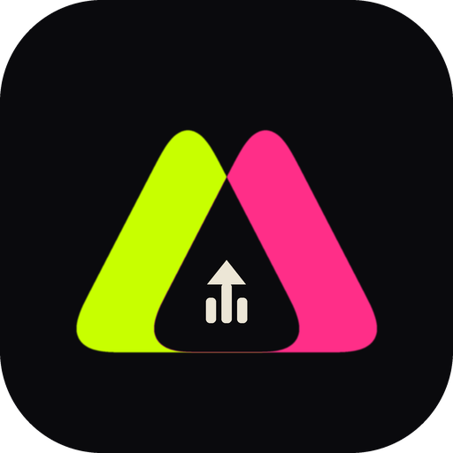
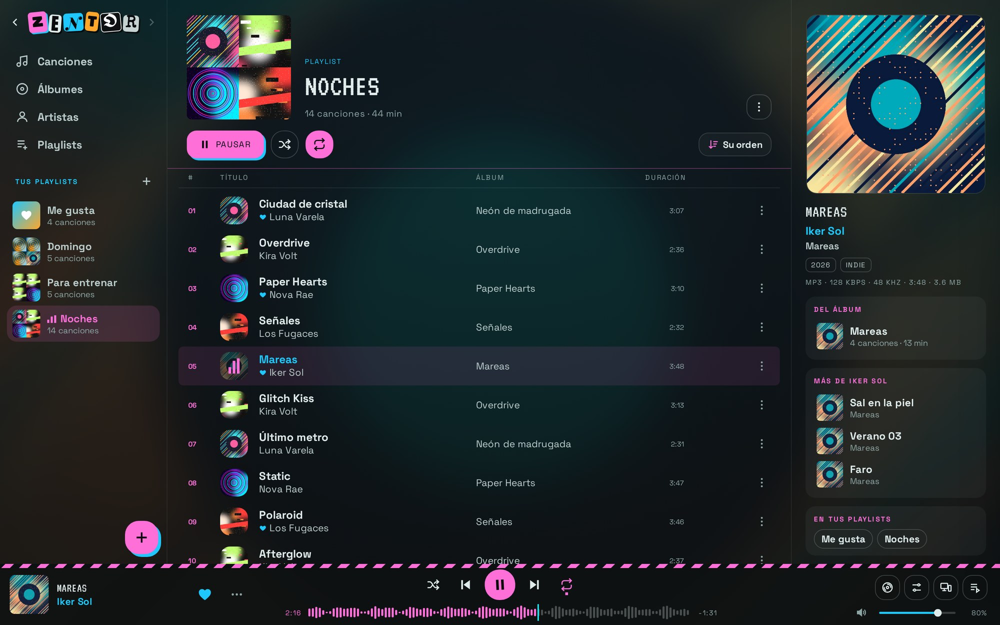
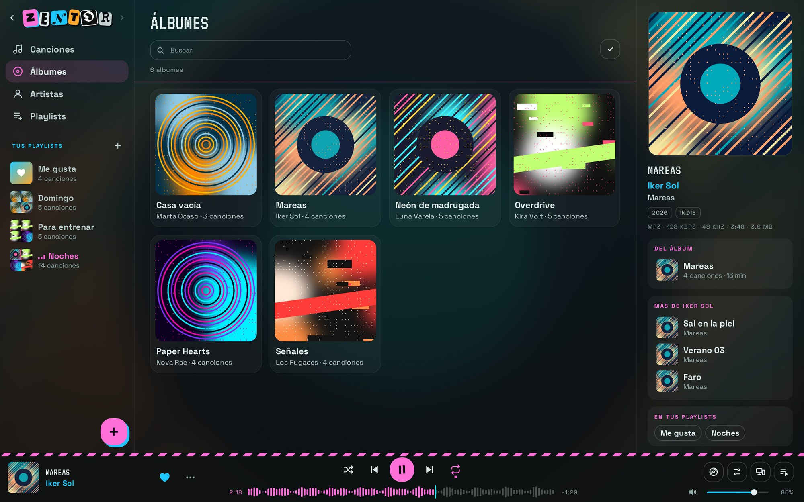
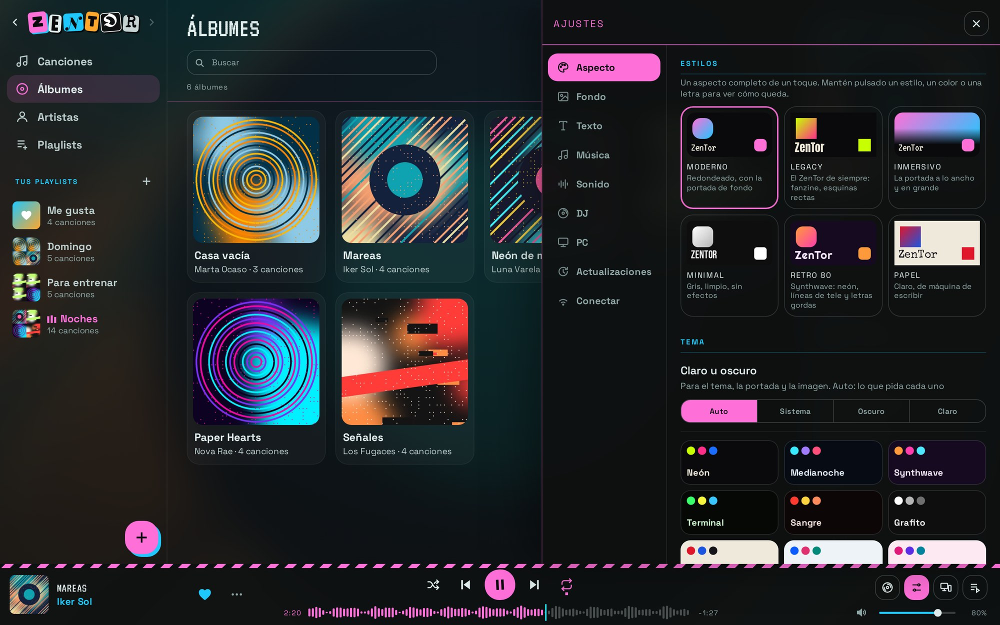
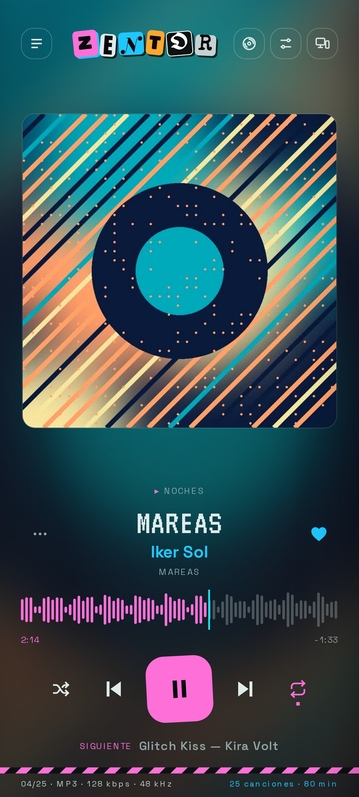
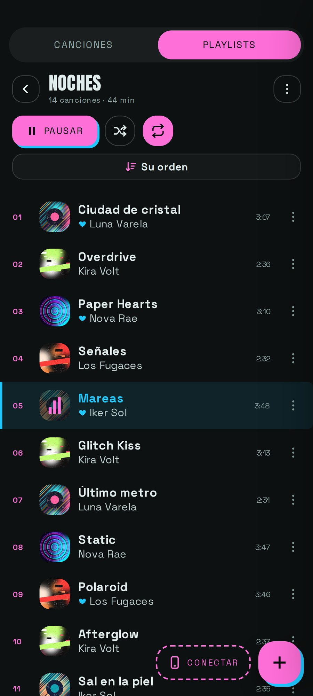
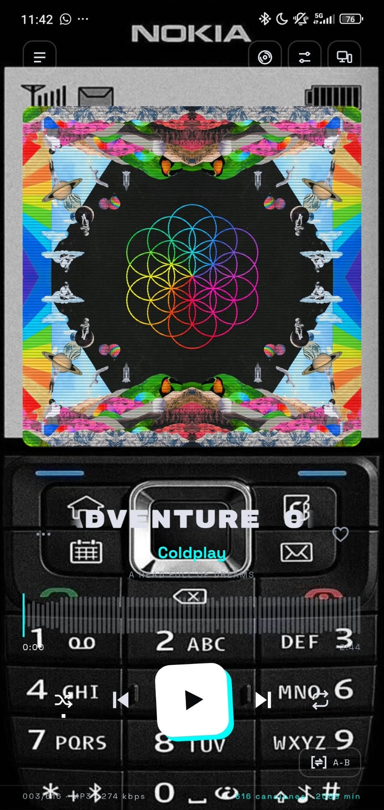

<div align="center">



# MixUp

**Tu música, mezclada como en una sesión.**<br>
Reproductor de música gratis para Windows, macOS y Android, con modo DJ, YouTube y Spotify, ecualizador y estética de fanzine.

[](https://github.com/luckicla/zentor/releases/latest)
[](https://github.com/luckicla/zentor/releases)


[](LICENSE)

### [⬇ Windows (instalador)](https://github.com/luckicla/zentor/releases/download/pc-latest/MixUp-Instalador.exe) · [⬇ Windows (portable)](https://github.com/luckicla/zentor/releases/download/pc-latest/MixUp-Portable.exe) · [⬇ macOS](https://github.com/luckicla/zentor/releases/download/mac-latest/MixUp-macOS.dmg) · [⬇ Android](https://github.com/luckicla/zentor/releases/download/android-latest/MixUp.apk)

[Web](https://luckicla.github.io/zentor/) · [English](https://luckicla.github.io/zentor/en/) · [Todas las versiones](https://github.com/luckicla/zentor/releases)



</div>

---

## Índice

- [Qué hace](#qué-hace)
- [Capturas](#capturas)
- [Descargar e instalar](#descargar-e-instalar)
- [¿Es seguro?](#es-seguro)
- [Cómo está hecho](#cómo-está-hecho)
- [Compilar](#compilar)
- [Créditos y licencia](#créditos-y-licencia)

## Qué hace

| | |
|---|---|
| 🎚️ **Modo DJ** | Analiza cada canción (tempo, tono, energía, estructura) y las mezcla en el mejor momento. Con estilos (Suave, Fiesta, Chill), mezclas cortas o largas y «Variedad». |
| ▶️ **YouTube y Spotify** | Pega un enlace (canción, playlist o álbum) o busca por nombre. Escúchala y descárgala para tenerla sin internet. De Spotify, si ya la tienes suena la tuya. |
| 📁 **Tu música** | mp3, m4a, flac, ogg, opus y wav, estén en la carpeta que estén. Lee etiquetas y letras, busca las portadas que faltan, detecta repetidas y trae foto y biografía de los artistas. |
| 🔊 **Suena mejor** | Ecualizador, refuerzo de graves, «Mejorar sonido» para auriculares baratos, igualar volumen, fundido cruzado y salto de silencios. |
| ✨ **Aleatorio inteligente** | Pone la que mejor va después y, de vez en cuando, una parecida de YouTube. Al acabar la lista, sigue con música parecida. |
| 🔄 **PC y móvil juntos** | Escanea un código y se sincronizan playlists, Me gusta y música, por tu WiFi, sin cuentas ni nube. Controla desde uno lo que suena en el otro. |
| 🎨 **A tu gusto** | Temas, colores, fondo, portada, letras, efectos e icono. En español, inglés y catalán, con estadísticas y tu propio Wrapped. |

## Capturas

<p align="center">
  
  
</p>
<p align="center">
  
  
  
  
</p>

<sub>Las canciones, artistas y portadas de las capturas de PC y de las dos primeras del móvil son inventados (salen solas con el workflow «Capturas», `tools/screenshots/`); las dos últimas son del móvil de Kilphys, con sus fondos.</sub>

## Descargar e instalar

| | Archivo | |
|---|---|---|
| **Windows** (instalador) | [`MixUp-Instalador.exe`](https://github.com/luckicla/zentor/releases/download/pc-latest/MixUp-Instalador.exe) | Se instala como una app más (menú Inicio y, si quieres, escritorio). |
| **Windows** (portable) | [`MixUp-Portable.exe`](https://github.com/luckicla/zentor/releases/download/pc-latest/MixUp-Portable.exe) | Sin instalar, para un USB: la música y los ajustes van en el propio USB (en `.zentor`). |
| **macOS** 11+ (Apple Silicon e Intel) | [`MixUp-macOS.dmg`](https://github.com/luckicla/zentor/releases/download/mac-latest/MixUp-macOS.dmg) | Abre el `.dmg` y arrastra MixUp a Aplicaciones. Para abrirlo la primera vez, mira [¿Es seguro?](#es-seguro). |
| **Android** 7+ | [`MixUp.apk`](https://github.com/luckicla/zentor/releases/download/android-latest/MixUp.apk) | Se instala a mano. En la [web](https://luckicla.github.io/zentor/#movil) hay un QR para bajarla al móvil. |

- Todas **se actualizan solas** cuando sale versión nueva (la portable avisa y te deja bajarla).
- En Windows, la ventana es de Edge en modo aplicación (viene con Windows); si no tienes Edge, usa Chrome o Brave.
- En Android sigue sonando con la pantalla apagada y tiene controles en la notificación y en la pantalla de bloqueo. Lo que añadas desde la app va a `Música/MixUp`.
- Si tenías el `ZenTor.exe` o el `MixUp.exe` de un solo archivo, se pasa solo a la app con instalador (o a la portable, si está en un USB) sin perder nada.
- **Versiones:** desde el cambio de nombre empezó la 2.0.0. Van 2.0.1, 2.0.2… hasta la 2.0.99, y luego la 2.1.0.

## ¿Es seguro?

**Sí.** Windows, macOS y Android pueden decir que es «peligroso» porque **no está firmado** con un certificado de pago y no viene de una tienda, no por lo que hace.

<details>
<summary><b>Qué hacer con los avisos y qué hace MixUp de verdad</b></summary>

<br>

- **Windows («Windows protegió su PC»)**: pulsa *Más información → Ejecutar de todas formas*. Windows desconfía de cualquier programa sin una firma comprada (cuesta cientos de euros al año). Algún antivirus también puede marcarlo por sospecha; pasa mucho con programas en Go sin firmar.
- **macOS («no se puede abrir» o «no se ha podido verificar»)**: la primera vez, haz clic con el botón derecho en MixUp → *Abrir*. Si no aparece el botón, ve a *Ajustes del Sistema → Privacidad y seguridad* y pulsa *Abrir igualmente*. macOS desconfía de las apps que no llevan un certificado de pago de Apple, y MixUp no lo tiene; no es por lo que hace.
- **Android (Play Protect)**: pulsa *Más detalles → Instalar de todas formas* y, si lo pide, permite instalar apps de esa fuente. La APK va firmada con una clave de desarrollo pública (`android/app/zentor-dev.keystore`), no con una de Google.

Lo que hace:

- El `.exe` y la `.apk` los compila **GitHub Actions** a partir de este mismo código (`.github/workflows/android.yml`), no mi ordenador.
- Solo lee y guarda en tu carpeta de música y en su carpeta de datos. No toca nada más del sistema.
- Solo se conecta a internet para lo que usas: YouTube y YouTube Music, Spotify (los enlaces que pegas), Deezer, iTunes y Wikipedia (portadas e info de artistas) y GitHub (actualizaciones). Sin cuentas, sin anuncios, sin mandar tus datos a ningún sitio.
- En el PC abre un puerto en tu red local para sincronizar con el móvil; por eso Windows puede pedir permiso en el cortafuegos.

**Compruébalo tú:** sube el archivo a [VirusTotal](https://www.virustotal.com) (más de 70 antivirus a la vez), o pásale este repo a una IA como Claude y pídele que te explique qué hace cada parte.

</details>

## Cómo está hecho

Una sola interfaz web (HTML, CSS y JavaScript sin frameworks, en `web/`) para las dos plataformas:

- **PC**: un servidor pequeño en Go que sirve la interfaz y abre su propia ventana. El `.exe` lleva `web/` dentro (`go:embed`), por eso el código Go va en la raíz, junto a `web/`.
- **Android**: la misma interfaz en un WebView, con un servidor en Java que da la misma API.

```text
.
├── main.go, server.go     arranque y API (canciones, audio, portadas, ajustes)
├── library.go, tags.go    busca tu música y lee sus etiquetas (ID3v2, FLAC, mp4.go para m4a)
├── youtube.go             las canciones de YouTube en tu biblioteca
├── ytdirect.go            el audio de YouTube, rápido: directo de la API de YouTube
├── ytdlp.go, ytcache.go   y con yt-dlp cuando eso no basta (y para descargar)
├── ytmusic.go             búsquedas, álbumes y radios de YouTube Music
├── dj.go                  guarda los análisis del modo DJ
├── lan.go                 sincronización con el móvil
├── update.go, install_*   actualizaciones e instalación
├── *_windows.go           lo que solo existe en Windows (con su *_other.go para el resto)
├── web/                   la interfaz: app.js, library.js, dj.js, youtube.js, sync.js, i18n.js…
├── android/               la app de Android (Java + Gradle)
├── desktop/               archivos del instalador
├── docs/                  la web (luckicla.github.io/zentor), en español y en inglés
├── tools/                 iconos, capturas automáticas y pruebas
└── notas/                 encargos y notas de diseño
```

La app la he hecho yo. Me he ayudado de Claude, la IA de Anthropic, para arreglar errores y en algunas partes, pero no ha hecho toda la app.

## Compilar

Hace falta Go 1.22 o más nuevo.

```sh
go build -o mixup .      # para probar en Linux/macOS: ./mixup -root ~/Música
go test ./...            # pruebas
./build.sh               # MixUp.exe para Windows (mete el icono si tienes llvm-rc/llvm-cvtres)
```

La APK: Android Studio, o `gradle assembleRelease` dentro de `android/` con el SDK de Android.

GitHub Actions compila el exe y la APK en cada cambio y los sube a las releases `pc-latest` y `android-latest`, que es de donde se actualizan las apps.

## Créditos y licencia

- **luckicla**: quien hace MixUp. Antes se llamaba ZenTor; desde la 2.0.0 se llama MixUp.
- **Kilphys**: la persona por la que existe este proyecto y para la que se hizo. Gracias por todo.

MixUp es de código abierto para uso **no comercial**, con la licencia [PolyForm Noncommercial 1.0.0](LICENSE). © 2026 luckicla.

- **Puedes** ver el código, usarlo, aprender de él, cambiarlo y compartirlo, siempre que no sea para ganar dinero y mantengas el aviso de copyright y la licencia.
- **No puedes** venderlo, cobrar por él ni usarlo para fines comerciales. Si quieres usarlo de forma comercial, pídeme permiso.

El nombre «MixUp» y sus logos son míos: si publicas una versión cambiada, ponle otro nombre y otro logo.
