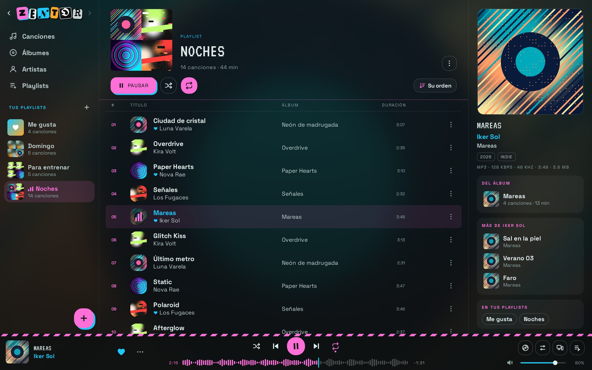
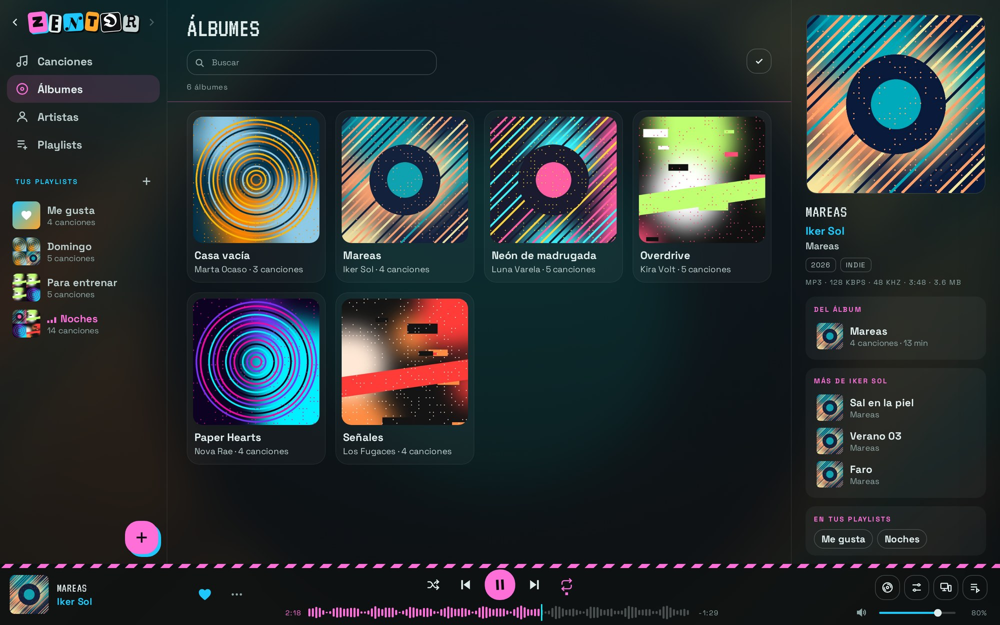
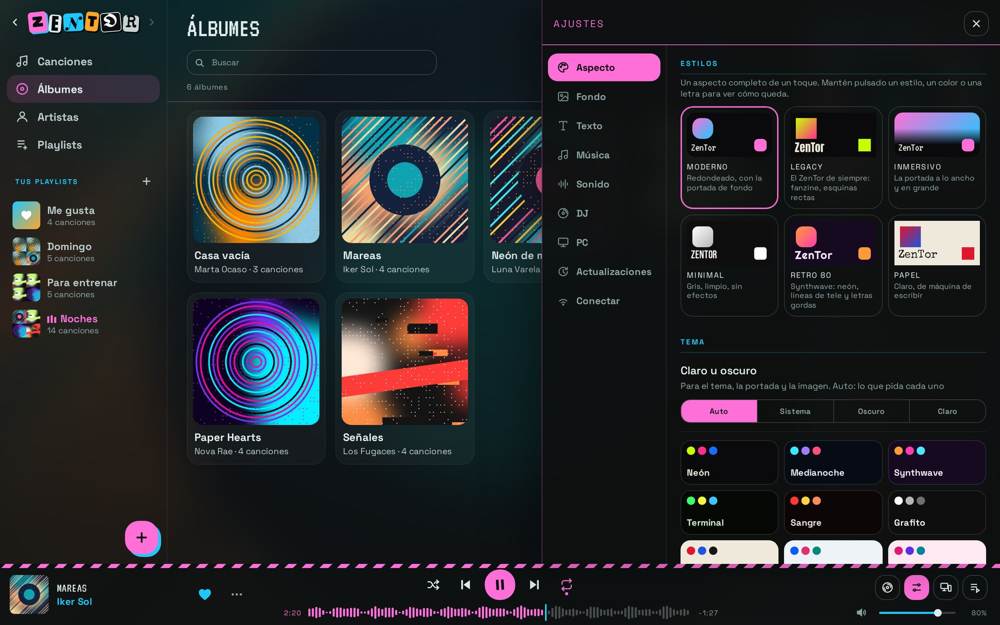
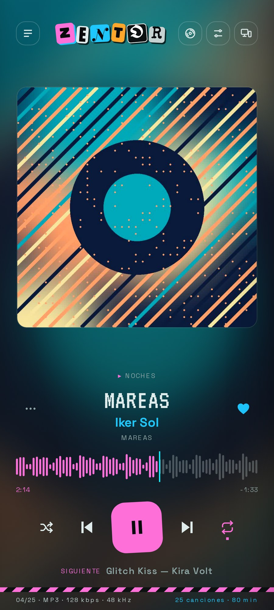
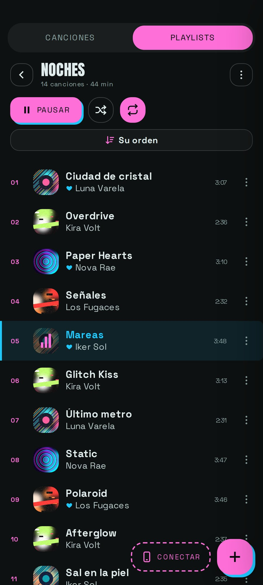

# ZenTor

ZenTor es mi reproductor de música. Lo hice porque quería algo para escuchar mi música en un pendrive sin instalar nada, y al final ha acabado siendo un reproductor completo para PC y para Android, con estética de fanzine (recortes, letras torcidas, rayas de peligro y todo eso).


## Colaboradora principal

**Kilphys**: la persona más importante para ZenTor y su principal colaboradora. Gracias por todo.

## Capturas

En el PC:



<p>
  
  
</p>

En el móvil:

<p>
  
  
</p>

Las canciones, los artistas y las portadas de las capturas son inventados, para no enseñar música de nadie. Las capturas se sacan solas con el workflow «Capturas» (`tools/screenshots/`).

## Descargar

Lo tienes todo en [Releases](https://github.com/luckicla/zentor/releases/latest):

- **Windows**: `ZenTor.exe`. Es un solo archivo, no hay que instalar nada.
- **Android**: `ZenTor.apk`. Se instala a mano (Android 7 o más nuevo).

Las dos se actualizan solas cuando saco versión nueva. Si Windows o Android te dicen que es peligroso, lee [¿Es seguro?](#es-seguro-por-qué-windows-y-android-avisan), que está explicado.

Las versiones van así: 1.5.1, 1.5.2… hasta la 1.5.100, y ahí pasa a la 1.6.1. Cada 100 sube el número del medio.

## Qué hace

**Tu música**
- Lee toda tu música (mp3, m4a, flac, ogg, opus, wav), da igual en qué carpetas esté.
- Saca título, artista, álbum, portada y letra de las etiquetas. Si un archivo no tiene etiquetas, usa el nombre (`Canción - Artista.mp3`).
- Si falta alguna portada, la busca sola y la guarda en el archivo.
- Canciones, álbumes, artistas (con foto y biografía de Deezer y Wikipedia) y tus playlists.
- Arrastras canciones a la ventana y se copian a tu carpeta `Música`.
- Busca canciones repetidas y deja solo la mejor.
- Se acuerda de por dónde ibas, también de la playlist en la que estabas.

**Reproducir**
- Aleatorio, repetir, cola, «Anterior» que vuelve a la canción que sonó de verdad, teclas multimedia y temporizador para que se pare solo.
- Fundido cruzado, salto de silencios al principio y al final, e «Igualar volumen» para que todas suenen parecido.
- Ecualizador, refuerzo de graves y «Mejorar sonido» para los auriculares baratos y el Bluetooth.

**Modo DJ**
- Mezcla las canciones como en una sesión. Analiza cada una (tempo, tono, energía, estructura) y elige la siguiente que mejor pega y el mejor momento para meterla.
- Tiene estilos (Suave, Fiesta, Chill), mezclas cortas o largas, «Variedad» para que no canse y la opción de colar de vez en cuando alguna de tu otra música o de YouTube.

**YouTube y Spotify**
- Pegas un enlace de YouTube, YouTube Music o Spotify (canción, playlist o álbum) y lo trae. De Spotify, si la canción ya la tienes suena la tuya; si no, la busca en YouTube.
- Puedes buscar música por nombre, escucharla y descargarla para tenerla sin internet.
- En el móvil también va con *Compartir → ZenTor* desde esas apps.

**PC y móvil juntos**
- Conectas el móvil con el PC escaneando un código (misma WiFi, sin cuentas ni nube) y se sincronizan las playlists, los Me gusta y la música. Desde uno puedes ver y controlar lo que suena en el otro.

**A tu gusto**
- En Ajustes se puede cambiar casi todo: estilos ya hechos, temas claros y oscuros, colores, imagen de fondo, cómo sale la portada, las esquinas, las letras, los efectos y el icono de la app.
- Está en español, inglés y catalán. Por defecto usa el idioma del dispositivo.

## En Windows

Necesita Windows 10 u 11. La ventana de ZenTor es de Edge en modo aplicación (viene con Windows); si no tienes Edge, usa Chrome o Brave.

- **En un USB (portable)**: copia `ZenTor.exe` al USB con tu música y dale doble clic. Todo se guarda en el propio USB (en `.zentor`, una carpeta oculta), así que lo enchufas en otro PC y está todo igual. Si quieres, ZenTor se puede abrir solo al enchufar el USB.
- **En el PC**: ponlo en cualquier carpeta. Lee tu carpeta Música de Windows y guarda los ajustes en tu usuario.

## En Android

Instala `ZenTor.apk` (Android te pedirá permitir apps de esa fuente). Lee la música del móvil, sigue sonando con la pantalla apagada y tiene controles en la notificación y en la pantalla de bloqueo. Las canciones que añadas desde la app van a `Música/ZenTor`.

Cuando hay versión nueva te avisa, y al instalarla ZenTor se vuelve a abrir solo y te dice qué versión tienes.

## ¿Es seguro? Por qué Windows y Android avisan

**Sí, es seguro.** Windows y Android pueden decir que ZenTor es «peligroso», «no seguro» o incluso «malware», pero no es por lo que hace. Es porque **no está firmado** con un certificado de pago y no viene de una tienda oficial.

- **Windows (SmartScreen: «Windows protegió su PC»).** Windows desconfía de cualquier programa que no lleve una firma de código comprada (cuesta cientos de euros al año) y que todavía no se haya descargado mucho. Dale a *Más información → Ejecutar de todas formas*. Algún antivirus también lo puede marcar por pura sospecha; pasa mucho con programas hechos en Go que no están firmados.
- **Android (Play Protect: «App no segura» o «App bloqueada»).** Android avisa de cualquier app que no venga de Google Play. La APK va firmada con una clave de desarrollo pública (`android/app/zentor-dev.keystore`), no con una de Google. Dale a *Más detalles → Instalar de todas formas* y, si te lo pide, permite instalar apps de esa fuente.

Lo que hace de verdad ZenTor:

- Todo el código está aquí, abierto. El `ZenTor.exe` y la `ZenTor.apk` de las releases los compila **GitHub Actions** a partir de este mismo código (`.github/workflows/android.yml`), no mi ordenador.
- Solo lee y guarda en tu carpeta de música y en su carpeta de datos (`.zentor/` en el USB, o tu usuario). No toca nada más del sistema.
- Solo se conecta a internet para lo que usas: YouTube y YouTube Music (buscar y escuchar), Spotify (leer los enlaces que pegas), Deezer, iTunes y Wikipedia (portadas e info de artistas) y GitHub (mirar si hay actualizaciones). No tiene cuentas ni anuncios, y no manda tus datos a ningún sitio.
- En el PC abre un puerto en tu red local para sincronizar con el móvil cuando lo conectas. Por eso Windows puede pedirte permiso en el cortafuegos.

**Si quieres comprobarlo tú**, no hace falta que te fíes de mí:

- Sube `ZenTor.exe` o `ZenTor.apk` a [VirusTotal](https://www.virustotal.com), que lo pasa por más de 70 antivirus a la vez.
- O pásale el código (o el enlace a este repo) a una IA como Claude y pídele que lo revise y te explique qué hace cada parte.

## Cómo está hecho

En el PC es un servidor pequeño en Go que sirve la interfaz y abre su propia ventana. La interfaz es HTML, CSS y JavaScript sin frameworks, y el `.exe` la lleva dentro (`go:embed`). Cuando cierras la ventana, se cierra todo.

En Android es la misma interfaz dentro de un WebView, con un servidor pequeño en Java que lee la música del móvil.

```
main.go         arranque
library.go      busca y lee tu música
tags.go         etiquetas ID3v2 y FLAC, letra y duración
mp4.go          etiquetas y portadas de los m4a
server.go       la API: canciones, audio, portadas, ajustes
window.go       abre la ventana de Edge/Chrome
update.go       actualizaciones
youtube.go      las canciones de YouTube en tu biblioteca
ytdlp.go        bajar el audio de YouTube (con yt-dlp)
lan.go          sincronización con el móvil
dj.go           guarda los análisis del DJ
web/            la interfaz (app.js, library.js, settings.js, dj.js, youtube.js, sync.js, i18n.js…)
android/        la app de Android
```

La app la he hecho yo. Me he ayudado de Claude, la IA de Anthropic, para arreglar errores y en algunas partes, pero no ha hecho toda la app.

## Compilar

Hace falta Go 1.22 o más nuevo.

```sh
go build -o zentor .                     # para probar en Linux/macOS: ./zentor -root ~/Música
./build.sh                               # ZenTor.exe para Windows
```

`build.sh` mete el icono con `llvm-rc`/`llvm-cvtres` si los tienes; si no, compila sin icono.

La APK: Android Studio, o `gradle assembleRelease` dentro de `android/` con el SDK de Android. De todas formas, GitHub Actions compila el exe y la APK en cada cambio y los sube a las releases `pc-latest` y `android-latest`, que es de donde se actualizan las apps.

## Licencia

ZenTor es de código abierto para uso **no comercial**, con la licencia [PolyForm Noncommercial 1.0.0](LICENSE). © 2026 luckicla.

- **Puedes** ver el código, usarlo, aprender de él, cambiarlo y compartirlo, siempre que no sea para ganar dinero y mantengas el aviso de copyright y la licencia.
- **No puedes** venderlo, cobrar por él ni usarlo para fines comerciales. Eso solo lo puedo hacer yo. Si quieres usarlo de forma comercial, pídeme permiso.

El nombre «ZenTor» y sus logos son míos: si publicas una versión cambiada, ponle otro nombre y otro logo.
